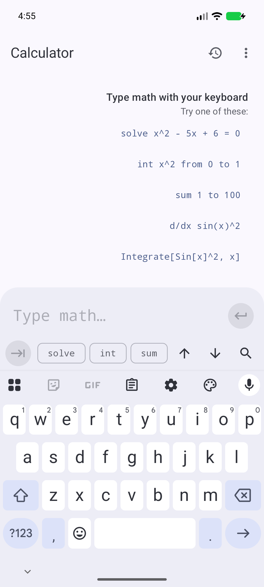
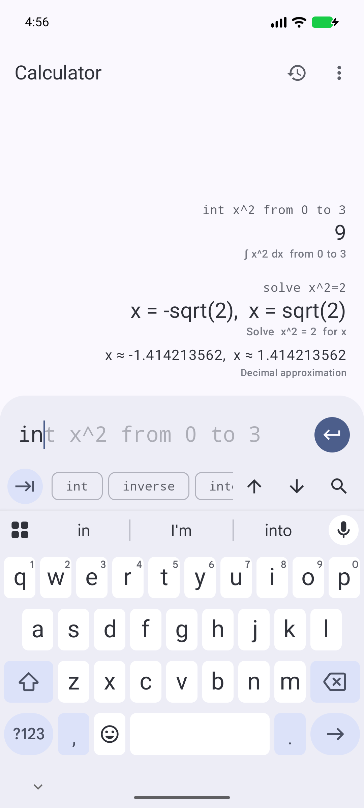
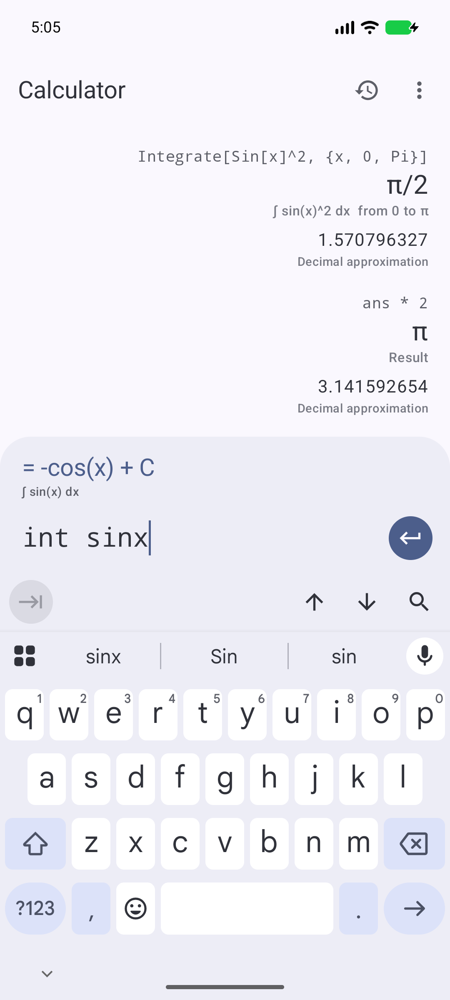

# Calculator

A symbolic + numeric calculator for Android 17 (API 37) that you type into with your
**normal phone keyboard**, in plain math / natural language or Wolfram Language syntax.
The math engine is the SymPy-based engine of the Flow Launcher **Solve** plugin, running on
the phone in an embedded CPython 3.14.

| Empty | Typing (fish-style ghost suggestion) | Fuzzy history search | Wolfram syntax + `ans` |
|---|---|---|---|
|  |  |  |  |

## What it does

```text
solve x^2 - 5x + 6 = 0          x = 2,  x = 3
int x^2                         x^3/3 + C
int x^2 from 0 to 1             1/3
int_0^pi sin x                  2
int e^(-x^2) from -oo to oo     sqrt(π)
sum 1 to 100                    5050          (every integer in the range)
sum k^2 from 1 to 10            385
sum 1/n^2 from n=1 to oo        π^2/6
d/dx x^3 e^x                    x^2*(x + 3)*exp(x)
lim x->0 sin(x)/x               1
Integrate[Sin[x]^2, {x, 0, Pi}] π/2
ans * 2                         uses the last result
```

* **Keywords:** `solve` solves, `int` integrates (indefinite or definite), `sum` adds all numbers
  in a range (or a series), plus `d/dx`, `lim`, `factor`, `expand`, `simplify`, `taylor`, matrices…
  Full reference: [docs/SYNTAX.md](docs/SYNTAX.md).
* **Live preview** of the result while you type; Enter (keyboard "Go" key or the ↵ button) stores it.
* **Accessory bar on top of the keyboard:** `⇥` Tab accepts the gray suggestion, completion chips,
  `↑`/`↓` history navigation, and a fuzzy **history search** button (Ctrl+R style).
* **Shell-like memory:** fish-style autosuggestions from history, de-duplicated history, `ans`.
* **History** saved as JSON in app storage, exportable/importable as a `.json` file.
* Material 3 with dynamic color (Material You), light/dark, edge-to-edge. No permissions.
* Runaway computations are killed after a time limit (the engine runs in its own process).
* Select text in any app, then choose **Calculator** in the selection menu to compute it.

## Install

The signed APK is at `dist/Calculator-1.0.0.apk` (arm64 phones, Android 8.0+, targets Android 17).
Copy it to the phone and open it, or with the phone connected over USB (Nushell):

```nu
^adb install -r dist/Calculator-1.0.0.apk
```

## Build

```nu
./gradlew assembleRelease     # -> app/build/outputs/apk/release/app-release.apk (signed from .env)
./gradlew testDebugUnitTest   # Kotlin unit tests (autocomplete, fuzzy search)
python engine-tests/test_engine.py   # CAS engine tests (needs sympy==1.14.0, mpmath==1.3.0)
```

Toolchain, versions and signing: [docs/BUILD.md](docs/BUILD.md).

## Documentation

| Doc | Contents |
|---|---|
| [docs/DECISIONS.md](docs/DECISIONS.md) | Every design choice and why (engine, process model, UI, keyboard, storage, versions) |
| [docs/ENGINE.md](docs/ENGINE.md) | How the CAS works: parsing pipeline, SymPy algorithms for integrals/sums/solve/limits, limits of the engine |
| [docs/SYNTAX.md](docs/SYNTAX.md) | Everything you can type |
| [docs/INPUT.md](docs/INPUT.md) | Keyboard, accessory bar, autocomplete, ghost suggestions, ↑/↓, fuzzy search |
| [docs/HISTORY_FORMAT.md](docs/HISTORY_FORMAT.md) | The JSON history file and export/import |
| [docs/BUILD.md](docs/BUILD.md) | Installed toolchain, versions research, build, signing secrets, emulator testing, quirks |

## Project layout

```text
app/src/main/python/calc_engine.py   CAS engine (SymPy), ported from the Flow "Solve" plugin
app/src/main/java/com/mattia/calculator/
  engine/      EngineService (:engine process, CPython) + EngineClient (IPC, timeouts, restarts)
  history/     HistoryStore (JSON file, atomic writes, export/import)
  input/       Completions, Fuzzy (fzf-style), ghost-text OutputTransformation
  ui/          Compose Material 3 screens (tape, input panel, accessory bar, sheets)
  CalculatorViewModel.kt, MainActivity.kt
engine-tests/test_engine.py          122 engine test cases
.env / keystore/                     release signing secrets (git-ignored)
dist/                                built APK
```
